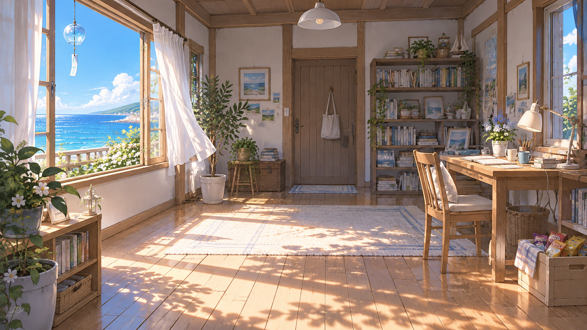
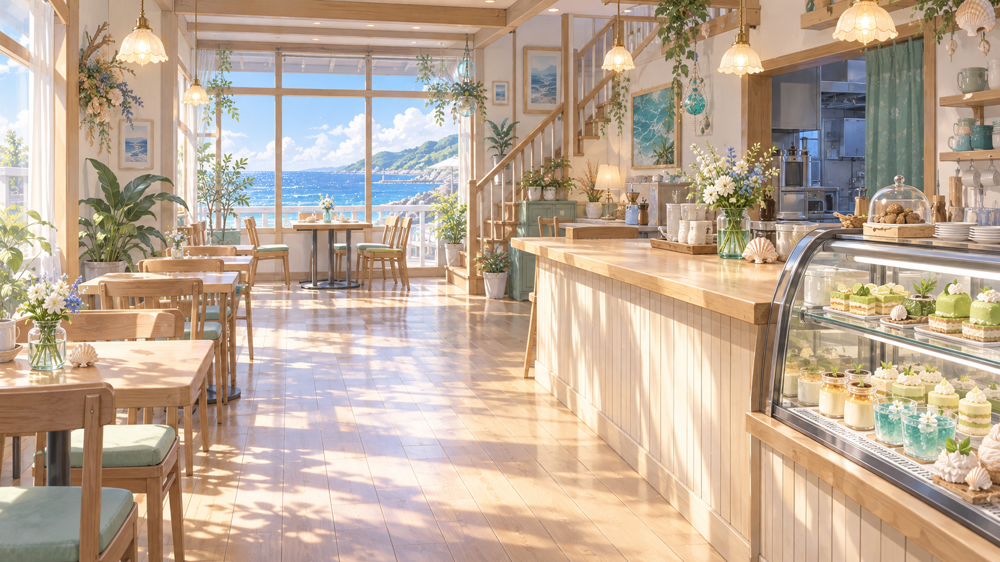
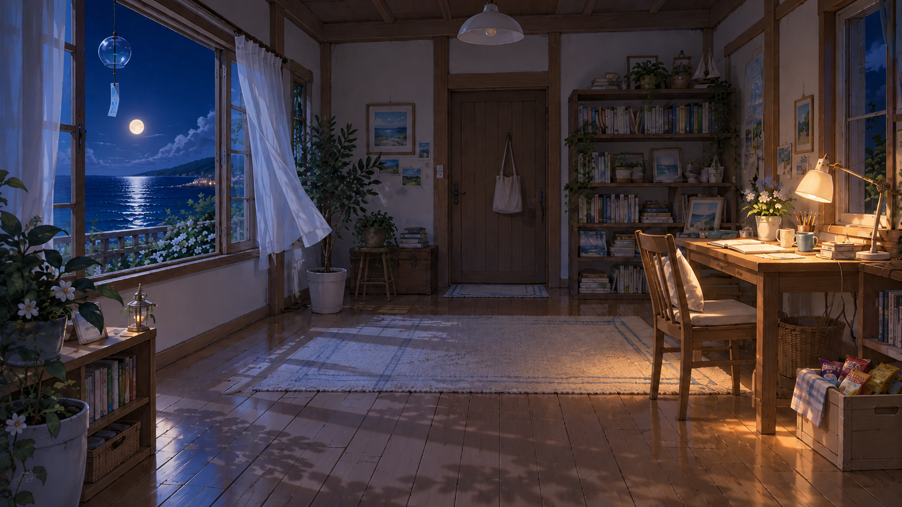
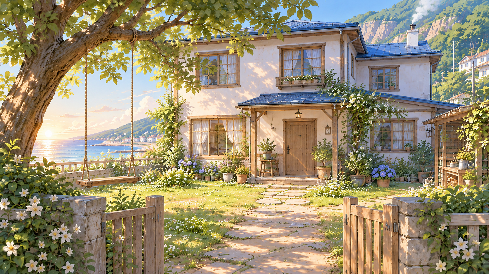
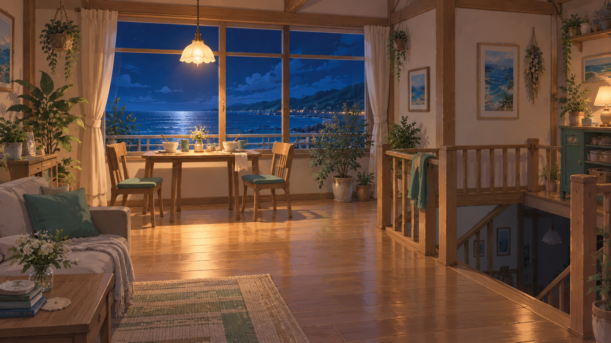
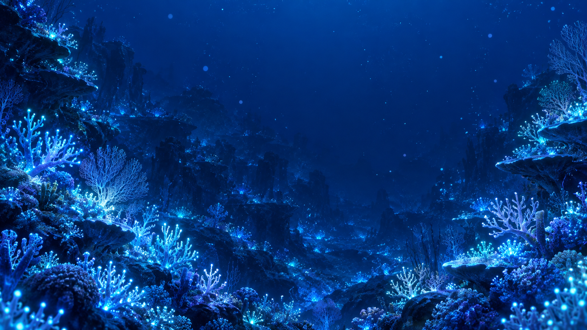

# 《海风与布丁》素材库

集中保存项目素材。当前归档 11 张背景、1 首配乐主曲、15 个环境音和 18 个剧情音效，保留原始素材内容，仅统一文件名。

环境音包括潮声、海鸥、水下声、集市、风铃、海风、点火、篝火和店内底噪，见 [音效索引](audio/sfx/README.md)。

## 背景索引

| ID / 文件 | 场景 | 用途 |
|---|---|---|
| [bg_shallows_day_v01.png](backgrounds/bg_shallows_day_v01.png) | 浅滩与礁石 · 白天 | 初遇、浅滩日常、礁石谈话 |
| [bg_house_study_day_v01.png](backgrounds/bg_house_study_day_v01.png) | 大房子的书房 · 白天 | 写稿、日记、电话、重要谈话 |
| [bg_emerald_dream_interior_day_v01.png](backgrounds/bg_emerald_dream_interior_day_v01.png) | 翡翠之梦店内 · 白天 | 经营日常、甜品验收、柜台谈话 |
| [bg_shallows_sunset_v01.png](backgrounds/bg_shallows_sunset_v01.png) | 浅滩与礁石 · 黄昏 | 黄昏散步、礁石谈话、手链代管 |
| [bg_shallows_night_v01.png](backgrounds/bg_shallows_night_v01.png) | 浅滩与礁石 · 月夜 | 海浪与诗句、夜间等待、读稿、季终回收 |
| [bg_house_study_night_v01.png](backgrounds/bg_house_study_night_v01.png) | 大房子的书房 · 夜 | 深夜写稿、日记、等待、最终页 |
| [bg_beach_campsite_night_v01.png](backgrounds/bg_beach_campsite_night_v01.png) | 浅滩帐篷外 · 夜 | 夜间谈心、坦白、讲故事 |
| [bg_town_market_day_v01.png](backgrounds/bg_town_market_day_v01.png) | 小镇集市 · 上午 | 逛街、采购、饰品摊、海鲜验收 |
| [bg_house_courtyard_morning_v01.png](backgrounds/bg_house_courtyard_morning_v01.png) | 大房子与院子 · 清晨 | 搬家、住宅外景、晨间出门 |
| [bg_emerald_dream_upstairs_night_v01.png](backgrounds/bg_emerald_dream_upstairs_night_v01.png) | 翡翠之梦二楼窗边 · 夜 | 打烊后、晚饭、放松谈心 |
| [bg_deepsea_coral_glow_v01.png](backgrounds/bg_deepsea_coral_glow_v01.png) | 深海发光珊瑚礁 | 深海之光、定情、记忆碎片 |

尺寸、文件大小、SHA-256、原始文件名与来源说明见 [manifest.json](manifest.json)。清单中的 `path` 相对于本目录。第二批的生成提示词见 [prompts_round2.md](prompts_round2.md)。

## 浅滩与礁石 · 白天   
## 大房子的书房 · 白天   
## 翡翠之梦店内 · 白天   
## 浅滩与礁石 · 黄昏   
## 浅滩与礁石 · 月夜   
## 大房子的书房 · 夜   
## 浅滩帐篷外 · 夜   
## 小镇集市 · 上午   
## 大房子与院子 · 清晨   
## 翡翠之梦二楼窗边 · 夜   
## 深海发光珊瑚礁   ## 后续收录约定

- 背景放 `backgrounds/`；立绘、CG、配乐、音效分别使用 `sprites/`、`cg/`、`audio/bgm/`、`audio/sfx/`，有素材时再建立目录。
- 文件名使用英文小写与下划线。背景格式为 `bg_<场景>_<时段>_v<两位版本号>.<扩展名>`；时段可用 `day`、`sunset`、`night`。
- 新版本保留旧版本；同场景时段差分沿用场景名称与构图。
- 每次加入素材同步更新清单，记录实际尺寸、来源与授权信息；不把来源不明的授权状态写成已获许可。
- 本目录为素材归档，尚未接入播放器或编译器。

## 权利说明

本目录图片由用户提供，并明确要求在本仓库归档。生成工具、模型及开放授权条款未提供；不默认适用引擎代码许可证。

剧情音效包含拍水、落水、书写、风铃、电话、深潜、滴水及喜剧重音，见 [剧情音效索引](audio/sfx/README.md#剧情音效)。

当前配乐探索素材：[翡翠之梦](audio/bgm/README.md)。配乐、环境音与剧情音效在此单独归档；接入以 LarryE135 提供的最新 DEMO 为基础，具体映射待核对。
